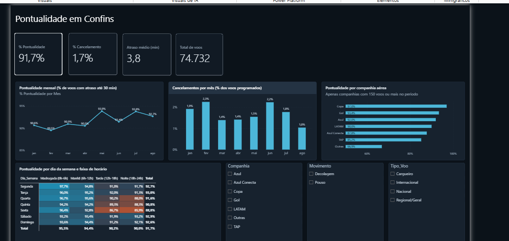

# Pontualidade de voos no Aeroporto de Confins (SBCF)

Análise da pontualidade, dos atrasos e dos cancelamentos de **74.732 voos** operados
em Confins (Belo Horizonte) entre **janeiro e agosto de 2026**, a partir dos dados
abertos da ANAC.

Pipeline completo: extração dos CSVs públicos, tratamento em Python/pandas, modelagem
dimensional e relatório em Power BI.



---

## Sumário

- [O problema](#o-problema)
- [Fonte dos dados](#fonte-dos-dados)
- [Arquitetura do pipeline](#arquitetura-do-pipeline)
- [ETL em Python](#etl-em-python)
- [Modelagem no Power BI](#modelagem-no-power-bi)
- [Medidas DAX](#medidas-dax)
- [Metodologia e decisões](#metodologia-e-decisões)
- [Resultados](#resultados)
- [Limitações](#limitações)
- [Como reproduzir](#como-reproduzir)
- [Estrutura do repositório](#estrutura-do-repositório)

---

## O problema

A ANAC publica mensalmente a base **VRA (Voo Regular Ativo)**, com uma linha por voo
operado no Brasil. São arquivos grandes, com uma linha por par origem–destino, e sem
nenhuma métrica calculada: não existe coluna de atraso, de pontualidade ou de faixa
de horário.

A pergunta que este projeto responde: **quando e por que os voos atrasam em Confins?**

Para respondê-la é preciso:

1. recortar, do volume nacional, apenas os voos que tocam SBCF;
2. transformar a perspectiva de "voo entre A e B" para "movimento em Confins"
   (decolagem ou pouso), porque o horário relevante muda conforme o caso;
3. calcular o atraso e classificar cada voo segundo o critério da ANAC;
4. decidir o que fazer com cancelados e voos extras, que não têm atraso mensurável.

---

## Fonte dos dados

| Item | Descrição |
|---|---|
| Base | VRA — Voo Regular Ativo |
| Órgão | ANAC — Agência Nacional de Aviação Civil |
| Portal | [Dados Abertos da ANAC](https://www.gov.br/anac/pt-br/assuntos/dados-e-estatisticas/dados-estatisticos) |
| Período | 01/2026 a 08/2026 (8 arquivos mensais) |
| Formato | CSV, separador `;`, codificação UTF-8 com BOM |
| Licença | Dados abertos governamentais |

Colunas de origem usadas: `Sigla ICAO Aeroporto Origem`, `Sigla ICAO Aeroporto Destino`,
`Partida Prevista`, `Partida Real`, `Chegada Prevista`, `Chegada Real`, `Situação Voo`,
`Situação Partida`, `Situação Chegada`, `Empresa Aérea`, `Sigla ICAO Empresa Aérea`,
`Número Voo`, `Código Tipo Linha`, `Modelo Equipamento`, `Número de Assentos`,
`Referência`.

> Os CSVs brutos não estão versionados por causa do tamanho. O script lê qualquer
> conjunto de arquivos `VRA_*.csv` colocados na pasta de entrada.

---

## Arquitetura do pipeline

```
dados_brutos/                 etl_voos_confins.py              dados_tratados/
VRA_2026_01.csv  ─┐                                        ┌─ voos_confins.csv
VRA_2026_02.csv   │     1. leitura + filtro SBCF           │   74.732 linhas
...               ├──▶  2. deduplicação                ───▶│   30 colunas
VRA_2026_08.csv  ─┘     3. parse de datas                  └─ pronto p/ Power BI
                        4. perspectiva do aeroporto
                        5. métricas de atraso
                        6. dimensões de calendário
                                                                     │
                                                                     ▼
                                                        Pontualidade_Confins.pbix
                                                        ├─ voos_confins (fato)
                                                        ├─ Calendario (dimensão)
                                                        └─ 15 medidas DAX
```

---

## ETL em Python

O script `etl_voos_confins.py` é idempotente e recebe pasta de entrada e arquivo de
saída como argumentos. Dependência única: **pandas**.

### 1. Leitura e empilhamento

Todos os arquivos são lidos com `dtype=str` para evitar que o pandas infira tipos
diferentes entre meses (um mês com `Número de Assentos` vazio viraria `float`, outro
`int`, e o `concat` geraria colunas mistas). A conversão de tipo é feita depois, de
forma explícita.

O filtro de Confins é aplicado **na leitura de cada arquivo**, antes do `concat`,
para não carregar o volume nacional inteiro na memória:

```python
d = pd.read_csv(f, sep=";", encoding="utf-8-sig", dtype=str)
d = d[(d["Sigla ICAO Aeroporto Origem"] == AEROPORTO)
      | (d["Sigla ICAO Aeroporto Destino"] == AEROPORTO)]
```

### 2. Deduplicação

Linhas idênticas em todas as colunas de negócio são removidas. A coluna de controle
`Arquivo_Origem` é excluída da chave, senão um voo repetido entre dois arquivos
mensais nunca seria detectado.

### 3. Perspectiva do aeroporto

Esta é a transformação central. Na base da ANAC cada linha é um trecho A→B. Para
analisar Confins, cada linha precisa virar **um movimento no aeroporto**:

| Caso | `Movimento` | `Horario_Previsto` | `Horario_Real` |
|---|---|---|---|
| Origem = SBCF | Decolagem | Partida Prevista | Partida Real |
| Destino = SBCF | Pouso | Chegada Prevista | Chegada Real |

```python
decola = df["Sigla ICAO Aeroporto Origem"] == AEROPORTO
df["Movimento"] = decola.map({True: "Decolagem", False: "Pouso"})
df["Horario_Previsto"] = df["Partida Prevista"].where(decola, df["Chegada Prevista"])
df["Horario_Real"]     = df["Partida Real"].where(decola, df["Chegada Real"])
```

O mesmo `where` constrói `Outro_Aeroporto`, que é o destino nas decolagens e a origem
nos pousos — a coluna usada para analisar rotas.

### 4. Métricas de atraso

```python
df["Cancelado"]   = df["Situação Voo"].str.upper().eq("CANCELADO")
df["Atraso_Min"]  = (df["Horario_Real"] - df["Horario_Previsto"]).dt.total_seconds() / 60
df.loc[df["Cancelado"], "Atraso_Min"] = pd.NA
df["Pontual"]       = (df["Atraso_Min"] <= 30).where(df["Atraso_Min"].notna())
df["Pontual_15min"] = (df["Atraso_Min"] <= 15).where(df["Atraso_Min"].notna())
```

O `.where(notna())` é deliberado: sem ele, `NaN <= 30` retorna `False`, e todo voo
cancelado seria contado como **atrasado** em vez de ficar fora da base de cálculo.
É o erro silencioso mais comum nesse tipo de análise e inflaria o atraso em cerca de
1,7 ponto percentual.

Valores negativos de `Atraso_Min` são voos adiantados e são preservados, não zerados
— por isso o atraso médio de 3,8 min é bem menor do que o atraso médio dos voos que
de fato atrasaram.

### 5. Saída inteira, não decimal

```python
for c in out.select_dtypes(include="float").columns:
    v = out[c].dropna()
    if (v == v.round()).all():
        out[c] = v.round().reindex(out.index).astype("Int64")
```

`Atraso_Min` sai do cálculo como `float` (`-6.0`). Gravado assim no CSV, o Power BI
em português lê o ponto como **separador de milhar** e transforma `-6.0` em `-60`.
Converter para `Int64` antes de gravar elimina o problema na origem, em vez de
remendar com configuração de localidade no Power Query.

### 6. Dimensões derivadas

A partir de `Referência` (data operacional, sempre preenchida): `Data`, `Ano`, `Mes`,
`AnoMes`, `Dia_Semana`, `Dia_Semana_Num`. A partir de `Horario_Previsto`:
`Hora_Prevista` e `Faixa_Horario` (Madrugada 0–6h, Manhã 6–12h, Tarde 12–18h,
Noite 18–24h). `Empresa Aérea` é normalizada em `Companhia` (os nomes razão social
variam entre meses).

### Saída

`dados_tratados/voos_confins.csv` — 74.732 linhas, 30 colunas, uma linha por
movimento em Confins.

---

## Modelagem no Power BI

Modelo estrela simples:

```
Calendario[Date]  1 ──── *  voos_confins[Data]
   (dimensão)                    (fato)
```

- **`Calendario`** criada em DAX, não no Power Query, para ficar desacoplada da
  base de fatos:

  ```dax
  Calendario =
  ADDCOLUMNS(
      CALENDAR(DATE(2026,1,1), DATE(2026,8,31)),
      "Ano",    YEAR([Date]),
      "MesNum", MONTH([Date]),
      "Mes",    FORMAT([Date], "mmm", "pt-BR"),
      "AnoMes", FORMAT([Date], "yyyy-mm")
  )
  ```

- Tabela marcada como **tabela de datas** (`Marcar como tabela de data`), requisito
  para as funções de inteligência temporal.
- Relacionamento **1:\*, direção única** (`Calendario` filtra `voos_confins`).
- `Mes` ordenado por `MesNum` (`Classificar por coluna`), senão o eixo sai em ordem
  alfabética: abr, ago, dez, fev…
- **Data/hora automática desativada** em Opções → Carregamento de dados. Com ela
  ligada o Power BI cria uma tabela de datas oculta para *cada* coluna de data, o
  que inchava o modelo com três hierarquias inúteis.

### Coluna calculada auxiliar

```dax
Faixa Ordem =
SWITCH(TRUE(),
    voos_confins[Hora_Prevista] < 6,  1,
    voos_confins[Hora_Prevista] < 12, 2,
    voos_confins[Hora_Prevista] < 18, 3,
    4
)
```

Usada para ordenar `Faixa_Horario`. Ela é derivada de `Hora_Prevista`, e **não** de
`Faixa_Horario` — ordenar uma coluna por outra calculada a partir dela mesma gera
dependência circular e o Power BI recusa.

---

## Medidas DAX

### Base

```dax
Total Voos = COUNTROWS(voos_confins)

Voos Medidos =
CALCULATE(
    [Total Voos],
    voos_confins[Cancelado] = FALSE(),
    voos_confins[Sem_Horario_Previsto] = FALSE()
)

Voos Pontuais       = CALCULATE([Total Voos], voos_confins[Pontual] = TRUE())
Voos Pontuais 15min = CALCULATE([Total Voos], voos_confins[Pontual_15min] = TRUE())
Voos Cancelados     = CALCULATE([Total Voos], voos_confins[Cancelado] = TRUE())
```

`Voos Medidos` é o denominador de toda a análise de pontualidade: exclui cancelados
e voos extras sem horário previsto. Separá-lo em uma medida própria evita repetir o
filtro em cada indicador e garante que todos usem a mesma base.

### Indicadores

```dax
% Pontualidade       = DIVIDE([Voos Pontuais], [Voos Medidos])
% Pontualidade 15min = DIVIDE([Voos Pontuais 15min], [Voos Medidos])
% Cancelamento       = DIVIDE([Voos Cancelados], [Total Voos])
Atraso Medio (min)   = AVERAGE(voos_confins[Atraso_Min])
```

`DIVIDE` em vez de `/` para tratar divisão por zero quando um filtro esvazia o
contexto (uma companhia sem voos no mês selecionado, por exemplo).

Note que `% Cancelamento` usa `Total Voos` como denominador, e não `Voos Medidos`:
cancelamento é proporção sobre tudo o que foi programado.

### Comparação temporal

```dax
% Pontualidade Mes Anterior =
CALCULATE([% Pontualidade], DATEADD(Calendario[Date], -1, MONTH))

Variacao Pontualidade (p.p.) =
VAR atual    = [% Pontualidade]
VAR anterior = [% Pontualidade Mes Anterior]
RETURN IF(ISBLANK(anterior), BLANK(), (atual - anterior) * 100)
```

A variação é devolvida em **pontos percentuais**, não em variação relativa. Dizer que
a pontualidade "caiu 2,6%" quando foi de 93,9% para 91,4% é ambíguo; "caiu 2,4 p.p."
não é. O `IF(ISBLANK(...))` evita que janeiro apareça com variação de +90,6 p.p.
contra um mês anterior inexistente.

### Benchmark

```dax
Pontualidade Geral (todas as cias) =
CALCULATE([% Pontualidade], ALL(voos_confins[Companhia]))

Diferenca vs Geral (p.p.) =
([% Pontualidade] - [Pontualidade Geral (todas as cias)]) * 100

Amostra Suficiente = IF([Voos Medidos] >= 150, 1, 0)
```

`ALL` remove apenas o filtro de companhia e preserva os demais (mês, movimento, tipo
de voo). Assim, ao comparar a Gol em julho, o benchmark é "todas as companhias em
julho", não "todas as companhias no período inteiro".

`Amostra Suficiente` é usada como filtro de visual para não publicar percentual de
companhia com pouquíssimos voos.

---

## Metodologia e decisões

| Decisão | Critério adotado | Por quê |
|---|---|---|
| Pontualidade | atraso ≤ **30 min** | critério oficial da ANAC; conferido contra as colunas `Situação Partida` / `Situação Chegada` da própria base |
| Critério alternativo | atraso ≤ **15 min** | padrão usado internacionalmente (OTP15); mantido em coluna própria para comparação |
| Voos cancelados | fora do cálculo de pontualidade, dentro do total | não têm horário real, logo não têm atraso; mas precisam contar no denominador do cancelamento |
| Voos extras sem horário previsto | marcados em `Sem_Horario_Previsto` e excluídos da pontualidade | sem horário programado não existe atraso a medir |
| Voos adiantados | atraso negativo, preservado | zerá-los inflaria artificialmente o atraso médio |
| Data de referência | coluna `Referência` da ANAC | é a data operacional do voo, sempre preenchida e dentro do mês do arquivo, ao contrário dos horários reais (um voo que decola 23h50 e pousa 00h30 pertence ao dia da operação) |

### Validações executadas

- Conferência da coluna `Pontual` calculada contra a `Situação` classificada pela
  própria ANAC.
- Checagem de que toda linha cai no mês do arquivo de origem (0 divergências).
- Conferência dos totais do Power BI contra os totais calculados em pandas.

---

## Resultados

### Visão geral (jan–ago/2026)

| Indicador | Valor |
|---|---|
| Voos no período | 74.732 |
| Voos com atraso medido | 71.901 |
| Pontualidade (≤ 30 min) | **91,7%** |
| Pontualidade (≤ 15 min) | 85,2% |
| Cancelamentos | 1,7% (1.256 voos) |
| Atraso médio | 3,8 min |

### Pontualidade mensal

| Mês | jan | fev | mar | abr | mai | jun | jul | ago |
|---|---|---|---|---|---|---|---|---|
| Pontualidade | 90,6% | 89,5% | 90,9% | 90,5% | 93,9% | 91,4% | 93,8% | 92,7% |
| Cancelamento | 1,9% | 2,3% | 1,4% | 1,4% | 1,5% | 2,2% | 1,8% | 1,0% |

Fevereiro é o pior mês nos dois indicadores. Agosto fecha o período com o menor
cancelamento (1,0%) e pontualidade de 92,7%.

### Por faixa de horário

| Faixa | Pontualidade |
|---|---|
| Madrugada (0h–6h) | 95,5% |
| Manhã (6h–12h) | 94,4% |
| Tarde (12h–18h) | 90,2% |
| Noite (18h–24h) | 90,0% |

**O atraso se acumula ao longo do dia.** A diferença de 5,5 p.p. entre a madrugada e
a noite é o padrão mais forte da base: atrasos da manhã se propagam pela malha, e o
avião que sai atrasado às 8h chega atrasado para o voo das 19h.

### Por dia da semana

Sexta-feira é o pior dia (88,8%) e terça o melhor (93,0%). O ponto mais crítico da
matriz é **sexta à tarde, com 86,7%**.

### Por companhia

| Companhia | Voos medidos | Pontualidade |
|---|---|---|
| Copa | 538 | 97,2% |
| Gol | 10.072 | 93,4% |
| Azul | 49.542 | 92,0% |
| LATAM | 9.036 | 90,0% |
| Azul Conecta | 2.053 | 87,8% |
| TAP | 479 | 85,2% |

> **Cuidado na leitura.** Copa e TAP operam menos de 600 voos no período, contra quase
> 50 mil da Azul. A diferença entre os extremos reflete tanto desempenho quanto
> perfil de operação: poucas frequências, rotas internacionais de longo curso e
> horários fixos têm dinâmica de atraso diferente de uma malha doméstica densa.
> Companhias com menos de 150 voos medidos foram agrupadas e não aparecem no gráfico.

---

## Limitações

- O período de 8 meses não permite isolar sazonalidade de tendência.
- A base VRA não traz **causa** do atraso (meteorologia, tráfego aéreo, manutenção,
  conexão de aeronave). A análise descreve o padrão, não o explica.
- Atraso é medido em relação ao horário **programado na publicação**. Remarcações
  antecipadas de malha não são capturadas.
- Confins é analisado isoladamente; atrasos importados de outros aeroportos aparecem
  como atraso em SBCF.

---

## Como reproduzir

### Pré-requisitos

- Python 3.10+
- pandas (`pip install pandas`)
- Power BI Desktop (opcional, para abrir o relatório)

### Passos

```bash
# 1. clonar
git clone https://github.com/ThianCris/pontualidade-confins.git
cd pontualidade-confins

# 2. baixar os CSVs mensais do VRA no portal da ANAC
#    e colocá-los em dados_brutos/ com o padrão VRA_AAAA_MM.csv

# 3. rodar o ETL
python etl_voos_confins.py dados_brutos dados_tratados/voos_confins.csv
```

Saída esperada no terminal:

```
VRA_2026_01.csv: 9243 voos em SBCF
...
------------------------------------------------------------
Voos lidos: 74732 | duplicatas removidas: 0 | voos na base: 74732
Periodo: 01/01/2026 a 31/08/2026
Cancelados: 1256 (1.7%) | voos extras sem horario previsto: 1575
Pontualidade ANAC (<= 30 min): 91.7% | <= 15 min: 85.2% | atraso medio: 3.8 min
Arquivo gerado: dados_tratados/voos_confins.csv
```

Em seguida abra `Pontualidade_Confins.pbix` e atualize a fonte apontando para o CSV
gerado.

---

## Licença

[MIT](LICENSE). Os dados são públicos e de domínio da ANAC.

---

## Estrutura do repositório

```
pontualidade-confins/
├── README.md
├── Medidas_DAX.md                       # todas as medidas documentadas
├── etl_voos_confins.py                  # pipeline de ETL
├── .gitignore
├── dados_brutos/                        # CSVs do VRA (não versionados)
├── dados_tratados/
│   └── voos_confins.csv                 # base tratada, entrada do Power BI
├── Pontualidade_Confins.pbix            # relatório
├── Pontualidade_Confins.Report/         # relatório em formato PBIP (texto)
├── Pontualidade_Confins.SemanticModel/  # modelo em formato PBIP (TMDL)
├── Confins_Tema_Escuro.json             # tema do relatório
├── painel_confins.html                  # versão web do painel, autocontida
└── docs/
    └── painel_powerbi.png               # print do relatório
```

As pastas `.Report` e `.SemanticModel` são o formato **PBIP** do Power BI: o mesmo
relatório salvo como arquivos de texto. Diferente do `.pbix`, que é binário, elas
permitem ver no `git diff` exatamente qual medida ou visual mudou em cada commit.

O CSV tratado (23 MB) está versionado de propósito: com ele o projeto é reproduzível
sem precisar baixar os 8 arquivos mensais da ANAC.

---

## Stack

`Python` · `pandas` · `Power BI` · `DAX` · `Power Query` · `Git`

---

Projeto de portfólio. Dados públicos da ANAC; nenhuma informação sensível ou
proprietária é utilizada.
